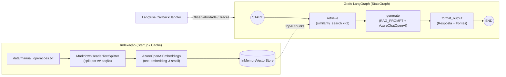

# Semana 3 — Exercício 1: Pipeline RAG de Operações Portuárias (LangGraph + Langfuse)

Resolução do **Exercício 1 da Semana 3 (RAG — Retrieval-Augmented Generation)**.  
Neste projeto, construímos um pipeline **RAG com LangGraph** que indexa documentos operacionais do porto em memória (`InMemoryVectorStore`), recupera os trechos mais relevantes por similaridade semântica com **Azure OpenAI Embeddings**, gera respostas fundamentadas estritamente no contexto recuperado com **Azure Chat OpenAI** e rastreia toda a execução via **Langfuse**.

---

## Arquitetura e Fluxo

O pipeline segue o fluxo linear de recuperação, geração fundamentada e formatação com citação explícita das fontes (`documento#secao`):



### Estado do Grafo (`State`)

Definido em [`src/graph/state.py`](src/graph/state.py):

| Campo | Tipo | Descrição |
| :--- | :--- | :--- |
| `pergunta` | `str` | Pergunta enviada pelo usuário na CLI ou interface visual. |
| `contextos` | `list[Document]` | Chunks recuperados do `InMemoryVectorStore` com metadados (`doc`, `secao`). |
| `resposta` | `str` | Texto gerado pelo LLM restrito ao contexto recuperado. |
| `resultado` | `str` | Saída final formatada contendo `Resposta:` e `Fontes: doc#secao`. |

---

## Estrutura do Projeto

```text
semana3-ex1/
├── data/
│   ├── manual_operacoes.txt       # Manual de Operações do Porto (base principal indexada)
│   ├── relatorio_frota.txt        # Relatório diário de situação da frota
│   └── avaliacao.json             # Conjunto de perguntas e respostas esperadas para validação
├── scripts/
│   ├── explorar_chunks.py         # Script rápido para inspecionar o particionamento dos chunks
│   └── debug_visual/
│       ├── server.py              # Servidor HTTP/SSE (porta 8765) com projeção PCA 2D e inspeção em tempo real
│       └── index.html             # Interface visual interativa do pipeline RAG
├── src/
│   ├── app/
│   │   └── main.py                # CLI interativa para perguntas ao pipeline RAG
│   ├── graph/
│   │   ├── builder.py             # Montagem e compilação do StateGraph (retrieve -> generate -> format_output)
│   │   ├── state.py               # Definição da TypedDict State
│   │   ├── nodes/
│   │   │   ├── retrieve.py        # Nó de busca semântica (k=2) na vector store
│   │   │   ├── generate.py        # Nó de geração de resposta com RAG_PROMPT + LLM
│   │   │   └── format_output.py   # Nó de formatação final com rastreabilidade das fontes
│   │   └── prompt/
│   │       └── rag_prompt.py      # Prompt de sistema anti-alucinação com fallback padronizado
│   └── utils/
│       ├── llm_adapter.py         # Fábricas get_llm() e get_embeddings() (Azure AI Foundry)
│       ├── vector_store.py        # Chunking por cabeçalho Markdown (##) e InMemoryVectorStore com @lru_cache
│       └── langfuse_client.py     # Integração opcional com Langfuse (CallbackHandler e flush)
├── requirements.txt
└── README.md
```

---

## Configuração do Ambiente

### 1. Criar e ativar o ambiente virtual

```powershell
python -m venv .venv
.\.venv\Scripts\Activate.ps1
pip install -r requirements.txt
```

### 2. Configurar variáveis de ambiente (`.env`)

Crie um arquivo `.env` na raiz do projeto com as credenciais do **Azure OpenAI** e (opcionalmente) do **Langfuse**:

```env
# Azure OpenAI (Obrigatório)
AZURE_OPENAI_ENDPOINT="https://<seu-recurso>.openai.azure.com/"
AZURE_OPENAI_API_KEY="<sua-chave>"
AZURE_OPENAI_DEPLOYMENT="gpt-4o-mini"
AZURE_OPENAI_EMBEDDING_DEPLOYMENT="text-embedding-3-small"
AZURE_OPENAI_API_VERSION="2024-10-21"

# Langfuse (Opcional — ativado automaticamente se preenchido)
LANGFUSE_PUBLIC_KEY="pk-lf-..."
LANGFUSE_SECRET_KEY="sk-lf-..."
LANGFUSE_HOST="https://cloud.langfuse.com"
```

---

## Como Executar

### 1. CLI Interativa Principal

Na raiz do projeto, execute o módulo principal:

```powershell
.\.venv\Scripts\python.exe -m src.app.main
```

Digite sua pergunta no terminal (ou `sair`, `exit`, `quit` para encerrar):

```text
Pergunta: Qual a velocidade segura em tempestade na rota direta?
Resposta: A velocidade máxima segura sob tempestade na rota direta (alto-mar) é de 12 nós.
Fontes: manual_operacoes#1. Limites de Velocidade por Condição Climática

Pergunta: Qual a velocidade máxima permitida em nevoeiro?
Resposta: Não encontrado no manual de operações.
Fontes: manual_operacoes#1. Limites de Velocidade por Condição Climática, manual_operacoes#6. Regras de Ancoragem e Espera
```

### 2. Inspecionar os Chunks Gerados

Para visualizar como o `MarkdownHeaderTextSplitter` divide o documento em seções e popula os metadados:

```powershell
.\.venv\Scripts\python.exe -m scripts.explorar_chunks
```

### 3. Debug Visual em Tempo Real (Interface Web)

O projeto conta com um painel web interativo que exibe em tempo real (via Server-Sent Events) todas as etapas do RAG: arquivos indexados, chunks gerados, **ranking de similaridade por cosseno**, **mapa vetorial PCA 2D**, prompt montado e execução nó a nó do LangGraph:

```powershell
.\.venv\Scripts\python.exe scripts\debug_visual\server.py
```

Depois, acesse no navegador: **[http://localhost:8765](http://localhost:8765)**

---

## Decisões Técnicas e Guardrails

- **Chunking Estrutural (`MarkdownHeaderTextSplitter`)**: O manual é dividido pelos cabeçalhos `##`, preservando cada seção temática íntegra e armazenando o nome da seção em `metadata["secao"]` e a origem em `metadata["doc"]`.
- **Prevenção de Alucinação (`RAG_PROMPT`)**: O modelo opera com `temperature=0.0` e instrução explícita para usar **somente** o contexto fornecido. Caso o assunto não conste nos trechos recuperados, responde exatamente: `"Não encontrado no manual de operações."`
- **Citação Automática de Fontes (`format_output`)**: Toda resposta apresenta ao final os identificadores `documento#secao` dos chunks utilizados na geração.
- **Observabilidade Transparente (`langfuse_client.py`)**: Se `LANGFUSE_PUBLIC_KEY` e `LANGFUSE_SECRET_KEY` estiverem definidos no `.env`, o `CallbackHandler` do Langfuse é injetado automaticamente no `graph.invoke(..., config=run_config())`.
